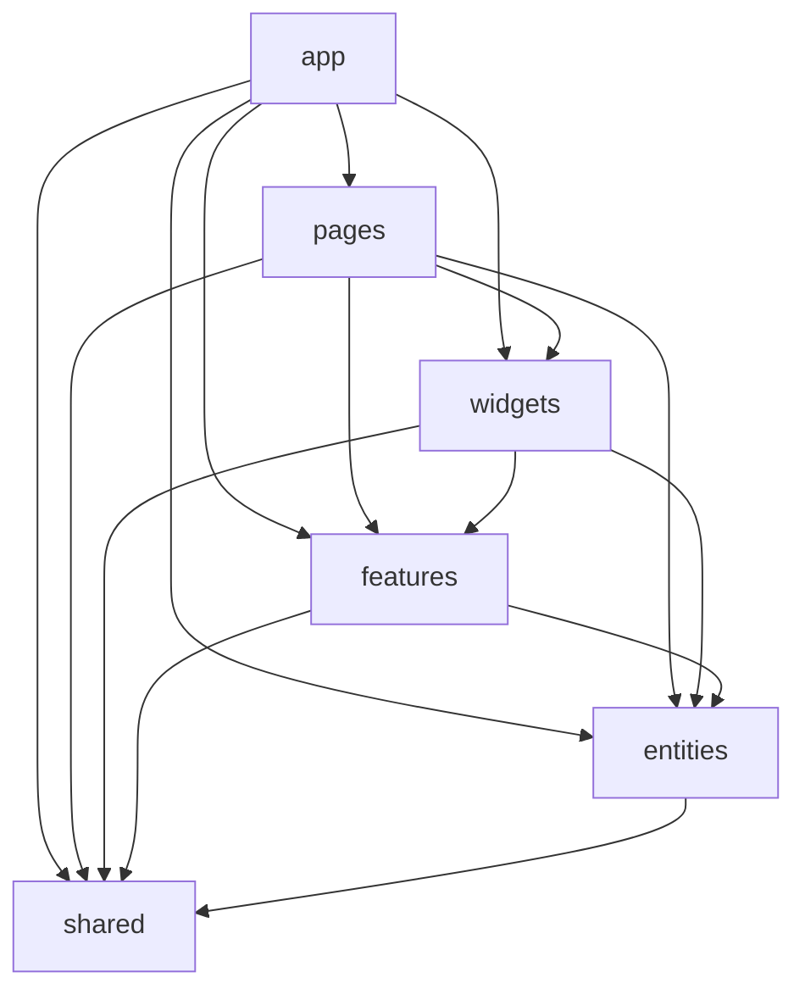

# Vue Lottery App

Vue 3 application developed for the Client Web Systems course.

The project was refactored using **Feature-Sliced Design (FSD)** and includes routing, authentication, user management, REST API integration, Pinia state management, reusable UI components and light/dark themes.

## Demo

GitHub Pages:

https://sebsnake2.github.io/vue-lottery-app/

## Repository

https://github.com/sebsnake2/vue-lottery-app

## Technologies

- Vue 3
- TypeScript
- Composition API
- Vite
- Vue Router
- Pinia
- pinia-plugin-persistedstate
- PrimeVue
- VeeValidate
- Yup
- SCSS
- Bootstrap
- REST API
- Feature-Sliced Design
- Steiger
- ESLint

## Features

- Client-side routing with Vue Router
- Lazy-loaded pages
- Authentication using JWT
- Protected routes with navigation guards
- User list from DummyJSON
- User search
- Pagination using query parameters
- User details page
- Create user
- Edit user
- Delete user with confirmation dialog
- Repository pattern for API access
- Pinia stores for application state
- Reusable UI wrappers
- Form validation with VeeValidate and Yup
- Light and dark themes
- Persisted theme state
- 404 page
- Dynamic browser page titles

## Feature-Sliced Design

The application follows the Feature-Sliced Design architecture.

```text
src/
├── app/
│   ├── providers/
│   ├── styles/
│   └── App.vue
│
├── pages/
│   ├── home/
│   ├── about/
│   ├── users/
│   ├── user-details/
│   ├── login/
│   └── not-found/
│
├── widgets/
│   ├── app-header/
│   └── users-table/
│
├── features/
│   ├── auth/
│   └── user-form/
│
├── entities/
│   ├── user/
│   ├── session/
│   └── setting/
│
└── shared/
    ├── api/
    └── ui/
```

### Layer responsibilities

- **app** — application initialization, providers, router integration and global styles.
- **pages** — application pages corresponding to routes.
- **widgets** — large independent UI blocks such as the application header and users table.
- **features** — user actions such as authentication and user forms.
- **entities** — business entities, stores, types and API services.
- **shared** — reusable API infrastructure and UI components.

## Architecture diagram



Dependencies follow the FSD rule: higher layers may depend only on lower layers.

## Repository pattern

API access is separated from application UI using the Repository pattern.

The application contains:

- shared HTTP client
- generic repository interfaces
- `UserService`
- `AuthService`
- universal `ServiceProvider`

Components and pages do not communicate with the REST API directly. They use Pinia stores and entity services.

## State management

Pinia is used for centralized application state.

Main stores:

- `useUsersStore` — user list, user details, loading state and CRUD operations.
- `useSessionStore` — authentication state and tokens.
- `useSettingsStore` — application theme.

`pinia-plugin-persistedstate` is used to persist application settings.

## UI library

PrimeVue is used through reusable wrappers located in `shared/ui`:

- `AppButton`
- `AppInput`
- `AppTable`
- `AppConfirmDialog`

Application pages and features use these wrappers instead of importing PrimeVue components directly.

## API

The project uses the public DummyJSON REST API.

API URL is stored in the environment configuration:

```env
VITE_API_URL=https://dummyjson.com
```

The `.env` file is not committed to the repository.

Use `.env.example` as an example.

## Installation

```bash
npm install
```

Create `.env`:

```env
VITE_API_URL=https://dummyjson.com
```

Run the development server:

```bash
npm run dev
```

## Build

```bash
npm run build
```

## Lint

ESLint:

```bash
npm run lint
```

FSD architecture validation:

```bash
npm run lint:fsd
```

## Author

Sebastian Burla

Information Technology student at Yuriy Fedkovych Chernivtsi National University.

GitHub: https://github.com/sebsnake2